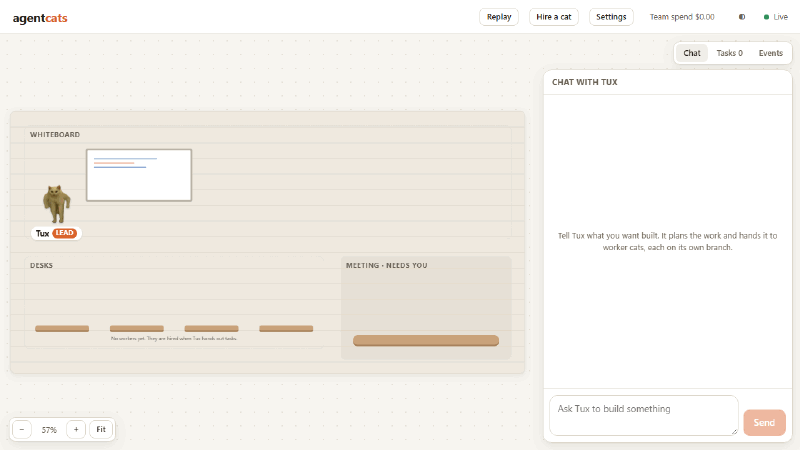

# agentcats

A local whiteboard where your coding agents are cats.
Tell the lead cat what you want built; it splits the work between worker cats, who each code on their own git branch, in parallel.
You watch them think, work and ask for permission in a little office, then review their branches and merge what you like.
The cats remember what they learn about your repo, level up from your reviews, and get hired through interviews.
They run on your own Claude Code or Codex, on your machine; nothing leaves it but what your agents send.



## Try it in a minute

```sh
npx agentcats --demo
```

The demo plays scripted cats in a throwaway project, so it needs no agent and spends nothing.
It does need Node.js 22.13 or newer and git.
One cat will ask you for permission; answer it.

## Use it on your project

1. Have [Claude Code](https://code.claude.com) installed and logged in, or Codex (`codex login`).
2. In a git repository with at least one commit, run:

   ```sh
   npx agentcats
   ```

3. Tell Tux, the lead, what you want in the chat, for example "Add a login endpoint and write tests for it".
4. Answer the cats' approvals. When their work is in review, check out their branches, merge what you like, and accept or reject it on the board.

`npx agentcats doctor` checks your setup if something does not start.

## What it does

- **A team, not a chat.** The lead plans and delegates; workers code in parallel, each in its own git worktree and branch, so your checkout is never touched. agentcats never merges or pushes.
- **You stay in charge.** Network access, installs, destructive commands and anything outside the rules ask you first, as a bubble on the cat. Pushing is refused.
- **Cats that learn.** Each worker keeps `learnings.md` about your repo, proposes new lines after a review, and earns XP from your verdicts. Higher levels load more of what they learned and run your project's scripts without asking.
- **Hiring by interview.** Candidates do the same task; agentcats runs hidden tests and scores them on diff size, cost, time and quality, and you pick.
- **Claude Code and Codex**, in one team if you like, and a mock for trying it out.
- **Replay** any past session at up to 16×, and export it, without file contents, for a bug report.
- **A cost meter**: spend over time, budgets left, the most expensive tasks.
- **Meme captions** when things go wrong or right, from a file you can edit, with a serious mode.

The [guide](docs/guide.md) covers all of it.

## Safety

- The daemon listens on `127.0.0.1` only, with a fresh token per run, and refuses other origins.
- Agents run under a guardian process and die with agentcats; leftovers are cleaned up on the next start.
- Secrets are redacted before anything is stored, shown, logged or exported.
- agentcats never handles your Claude or Codex credentials.

The limits are just as important; they are in [security](docs/security.md).

## Known limitations

- **Allowed commands run code the worker can change.** From level 3 a worker runs your scripts without asking, and it can edit what they run. On native Windows there is no OS sandbox around that.
- **Codex** is not checked action by action: its own sandbox keeps it in its worktree and off the network, and a network command is not asked about. It reports no cost, so its budget is working time. On Windows its sandbox is the weaker `unelevated` one.
- **Claude** on a subscription shows API-equivalent cost estimates, which are not enforced by default.
- **The mock** only acts out work; it never changes your repo.
- **Cats cannot be renamed** yet.
- **One team per project.** A second agentcats on the same project is refused.
- **The cat pictures** come from a public meme dataset whose rights are not fully clear; see [assets](docs/assets.md).

## Documentation

|                                        |                                                                             |
| -------------------------------------- | --------------------------------------------------------------------------- |
| [Guide](docs/guide.md)                 | Using the board, memory and levels, agents, hiring, replay, cost, captions. |
| [Configuration](docs/configuration.md) | Every key of `.agentcats/agentcats.config.json`.                            |
| [Security](docs/security.md)           | The threat model, the defaults and the gaps.                                |
| [Architecture](docs/architecture.md)   | How the daemon, the event log, adapters and the board fit together.         |
| [Writing an adapter](docs/adapters.md) | Add another agent and pass the conformance suite.                           |
| [Contributing](CONTRIBUTING.md)        | Setup, rules and pull requests.                                             |
| [Decisions](docs/decisions.md)         | Every technical decision, dated, and why.                                   |

## Terms

agentcats uses whatever authentication your agents are configured with; you are responsible for using them within their providers' terms.
The Claude adapter depends on the Claude Agent SDK (`@anthropic-ai/claude-agent-sdk`), which is not open source and is governed by [Anthropic's Commercial Terms of Service](https://www.anthropic.com/legal/commercial-terms).
agentcats does not redistribute it; your package manager installs it.

## License

MIT, see [LICENSE](LICENSE).
