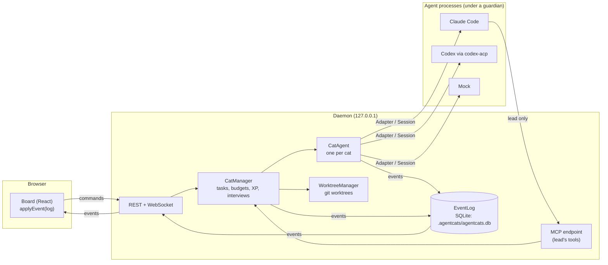

# Architecture

agentcats is one local process, the daemon, that owns the agent processes and keeps a log of everything they do.
The board in your browser is a projection of that log.

## Packages

| Package | Owns | Depends on |
| --- | --- | --- |
| `packages/protocol` | The contract: events, commands and routes, config, the task state machine, levels, the adapter interface, sessions and exports, secret redaction. No I/O. | zod |
| `packages/kit` | Process helpers: guarded spawn, tree kill, async queue. | nothing |
| `packages/daemon` | The team: cat manager, agents, worktrees, the event log, REST, WebSocket and MCP, memory, interviews, captions. | protocol, kit |
| `packages/adapters/*` | One agent each, behind the adapter interface: `claude`, `acp` (any ACP agent), `codex` (on top of `acp`), `mock`. `conformance` is the shared test suite. | protocol, kit, the agent's SDK |
| `packages/ui` | The board. | protocol |
| `packages/cli` | The `agentcats` command: config, adapter choice, `doctor`, `cleanup`, `--demo`. | everything |

Every event and command is defined in `packages/protocol` first; the daemon and the UI import them and never redefine them.
Each agent's SDK stays inside its adapter package, which ESLint enforces (`AGENT_SDKS` in `eslint.config.js`).

## Event flow

1. **An agent does something.** Its adapter turns that into an `AgentEvent`: a message chunk, a tool call starting or ending, an approval request, usage, the end of a turn.
2. **The cat's `CatAgent` translates it** into board events (`message.agent`, `tool.called`, `approval.requested`, `usage.updated`, `cat.status_changed`) and appends them to the log.
3. **`EventLog.append` is the one door into the log.** It redacts secrets, validates the event against the protocol, gives it the next sequence number, stores it in SQLite, applies it to the in-memory board with `applyEvent`, and broadcasts it.
4. **The board receives it over the WebSocket** and applies the same `applyEvent`. A gap in sequence numbers makes it fetch a fresh snapshot.
5. **The user acts** through REST commands (approve, review, pause, chat). The daemon carries them out and records the result as more events, so the log stays the only source of truth.

Because the board is `events.reduce(applyEvent, emptyBoard())`, a replay is the same function over stored events, and a restart rebuilds the board from the database.
Each run of the daemon starts with a `daemon.started` event, which is how replay finds sessions.

## The lead and the workers

- **The lead** (Tux) gets a read-only agent session plus the daemon's MCP tools: `list_cats`, `list_tasks`, `assign_task`, `get_task_status`, `get_task_result`, `cancel_task`, `retire_cat`, `list_interview_samples`, `propose_hire`. It plans and delegates; it cannot edit or run commands.
- **A worker** gets a task, its own git worktree and branch, and a prompt with its learnings and persona. When its turn ends, the daemon reads the branch's diff and the worker's summary and moves the task to review.
- **The task state machine** (`packages/protocol/src/task-machine.ts`) decides which moves are allowed: queued, running, blocked, review, then done or rejected; failed and interrupted tasks can be re-run.

## The adapter interface

An adapter (`packages/protocol/src/adapter.ts`) says what an agent can do and how to drive it:

- `capabilities`: MCP, approvals, resume, cost reporting, model selection, interrupt, permission modes, how policy is enforced (`hooks`, `sandbox` or `none`), and whether it can answer one-shot prompts.
- `modelTiers` and `estimateUsd(tier)`: the models behind fast, balanced and best, and what one interview candidate costs, if the adapter knows.
- `spawn(options)`: start a session in a working directory with a system prompt, a permission mode, an agent policy and MCP servers. Returns a `Session`: `send`, `events`, `approve`, `interrupt`, `kill`.
- `complete(options)`: answer one prompt without tools, for debriefs.
- `preflight()`: whether the agent is installed and logged in, without spending anything.

The event stream's guarantees (one `session.started` first, one `session.ended` last, turns that never overlap, approvals answered at most once) are written on `Session` and checked by the conformance suite.
[Writing an adapter](adapters.md) walks through adding one.

## Files on disk

| Where | What |
| --- | --- |
| `<repo>/.agentcats/agentcats.db` | The event log (SQLite). |
| `<repo>/.agentcats/cats/<name>/` | Each cat's `learnings.md`, `profile.md`, `stats.json`, `history/`. |
| `<repo>/.agentcats/run/` | `daemon.json` (the per-project lock) and `pids.json` (agent processes, for cleanup). |
| `<repo>/.agentcats/captions.json`, `agentcats.config.json`, `interviews/` | Yours to edit. |
| `~/.agentcats/worktrees/<project>-<hash>/` | Workers' worktrees and interview candidates' throwaway repos. |

## Decisions

Every decision behind this design, and every deviation from the plan, is in [decisions.md](decisions.md), dated.
